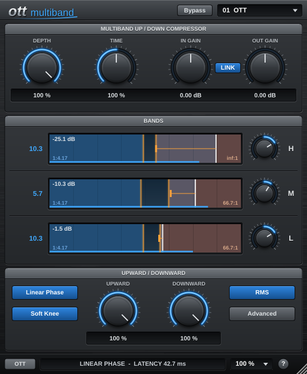
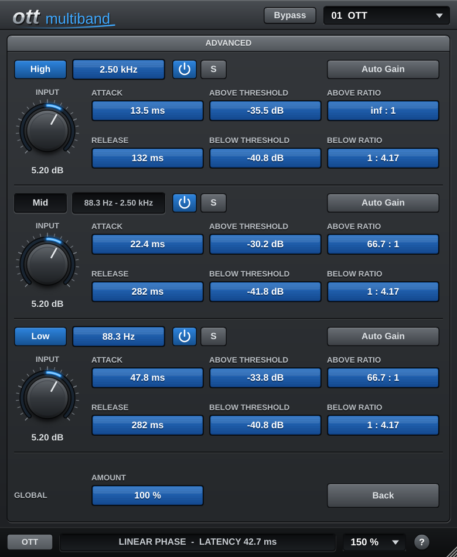

# OTT Multiband

A three-band upward + downward compressor (VST3, Windows) built with JUCE 8. It follows Ableton Live's
**OTT** Multiband Dynamics preset and Xfer Records' OTT: the same split points, gains, thresholds,
ratios and timings by default. It splits the bands with a **linear-phase** crossover, so the bands add
back up to the input with no phase shift. The GUI has the look and feel of VIRUS DELAY and is drawn
in code, with no image assets.



## Controls

The main view follows the layout of Xfer's OTT. The detailed settings are on the **Advanced** page.

| Section | Controls |
|---------|----------|
| **Top** | **Depth** (dry/wet), **Time** (scales every attack/release), **In Gain**, **Out Gain**. **LINK** (on by default): turning In Gain up turns Out Gain down by the same amount |
| **Bands** | One row per band (H / M / L). The number and knob are the band's output gain (default 10.3 / 5.7 / 10.3 dB). The bar runs from -80 dB (left) to 0 dB (right): the blue area is below the threshold (raised upward), the brown area is above it (pushed down). Drag an edge to move a threshold, and drag up/down inside an area to set its ratio. The white line is the input level, the orange marker shows where the compressor moves it, and the top-left number is the gain change |
| **Upward / Downward** | Scale each direction (as on Xfer OTT). **Linear Phase** on = no phase shift (~43 ms latency), off = zero latency. **Soft Knee**, **RMS** (off = peak detection), **Advanced** |
| **Advanced** | Per band: High / Low on/off + split frequency, power (off = band passes untouched), **S** (solo), **Auto Gain**, Input, Attack, Release, above/below threshold and ratio. Global: Amount (scales all compression) |
| **Bars** | **Bypass**, 10 factory presets, **Size** (75-200 %), help |



**Default (OTT) settings**

| Band | Input | Output | Attack | Release | Above thr. / ratio | Below thr. / ratio |
|------|-------|--------|--------|---------|--------------------|--------------------|
| High | 5.20 dB | 10.3 dB | 13.5 ms | 132 ms | -35.5 dB / inf : 1 | -40.8 dB / 1 : 4.17 |
| Mid  | 5.20 dB | 5.70 dB | 22.4 ms | 282 ms | -30.2 dB / 66.7 : 1 | -41.8 dB / 1 : 4.17 |
| Low  | 5.20 dB | 10.3 dB | 47.8 ms | 282 ms | -33.8 dB / 66.7 : 1 | -40.8 dB / 1 : 4.17 |

**Auto Gain** (per band) keeps the band's long-term loudness after compression equal to its
loudness before the band's Input knob. Raising Input then changes how hard the band is squashed, not
how loud it is. The band's output gain still trims on top.

### Mouse

* **Wheel**: 1.0 per notch in the control's own units (dB, ms, %, Hz, ratio). **Shift + wheel**: 0.1.
* **Drag** up/down (shift = fine). **Right-click** (or Ctrl-click) = type a value.
* **Double-click** resets: gain knobs go to **0 dB**, everything else goes to its default.
* **Resize** by dragging the bottom-right corner, or pick 75-200 % in **SIZE**. The window keeps
  its proportions, and the size is saved with the session.

## Linear-phase crossover

**Linear Phase** is on by default. Turn it off for a zero-latency crossover (4th-order Linkwitz-Riley
filters with a matching all-pass), which has phase shift around the split points. Switching fades out,
swaps the crossovers and fades back in, and the host is told about the new latency.

With Linear Phase on:

Two Kaiser-windowed FIR low-passes (LP1 at the low split, LP2 at the high split) run as FFT convolutions:

```
low  = LP1(x)
mid  = LP2(x) - LP1(x)
high = delay(x) - LP2(x)        ->  low + mid + high = delay(x), exactly
```

* The bands always sum back to the input. A null test with the compression off measures about -148 dB,
  even while the split points are moving.
* The filters are ~85 ms long at every sample rate, so the plugin reports **~43 ms latency** to the host
  (2048 samples at 48 kHz). Your DAW's delay compensation lines everything up. This latency is the cost
  of linear phase, so don't use the plugin on live input monitoring.
* New filters are designed off the audio thread and crossfaded in, so moving a split or switching a
  band on or off doesn't click.

## Project layout

```
CMakeLists.txt
.github/workflows/build.yml     Windows VST3 build -> artifact + "builds" branch
Source/
  Parameters.h                  IDs, ranges, OTT defaults, value formatting
  Presets.h                     factory presets
  PluginProcessor.h/.cpp        parameters, in gain, band split/compress/sum, solo/depth/bypass, state
  PluginEditor.h/.cpp           scalable main view + Advanced page
  CustomLookAndFeel.h/.cpp      knobs, buttons, panels, LCDs (from VIRUS DELAY)
  UI/OttComponents.h/.cpp       knob/value-field mouse handling, dynamics display, help
  DSP/LinearPhaseCrossover.*    FIR crossover (linear phase)
  DSP/MinPhaseCrossover.h       Linkwitz-Riley crossover (zero latency)
  DSP/BandCompressor.h          upward/downward compressor with auto gain
```

## Building (Windows)

Every push to `main` builds the plugin on GitHub Actions. Download **OTT-Multiband-VST3-Windows-x64**
from the run's artifacts, or the zip from the `builds` branch, and copy `OTT Multiband.vst3` into
`C:\Program Files\Common Files\VST3`.

Building locally needs CMake 3.22 or newer and Visual Studio 2022. JUCE 8.0.4 is downloaded automatically.

```bash
cmake -B build -G "Visual Studio 17 2022" -A x64
cmake --build build --config Release --target OTT_VST3
```

The output is `build/OTT_artefacts/Release/VST3/OTT Multiband.vst3`. Options: `-DOTT_BUILD_STANDALONE=ON`
(a test app), `-DOTT_COPY_AFTER_BUILD=ON` (installs after building), `-DJUCE_DIR=...` (uses a local JUCE).

## Notes

"OTT" is used here only to describe the processing style. This project contains no Xfer Records or
Ableton code, artwork or logos.
