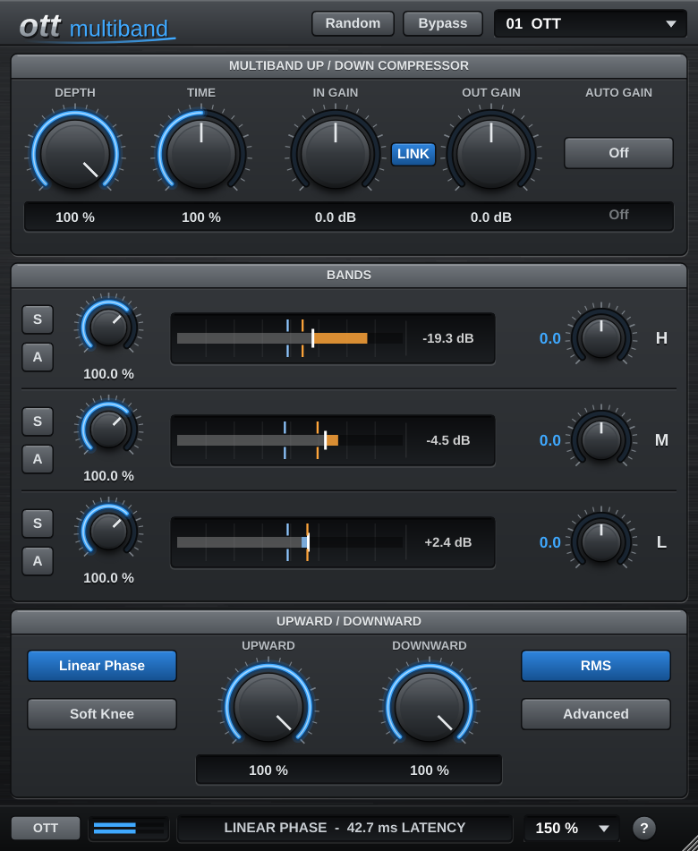
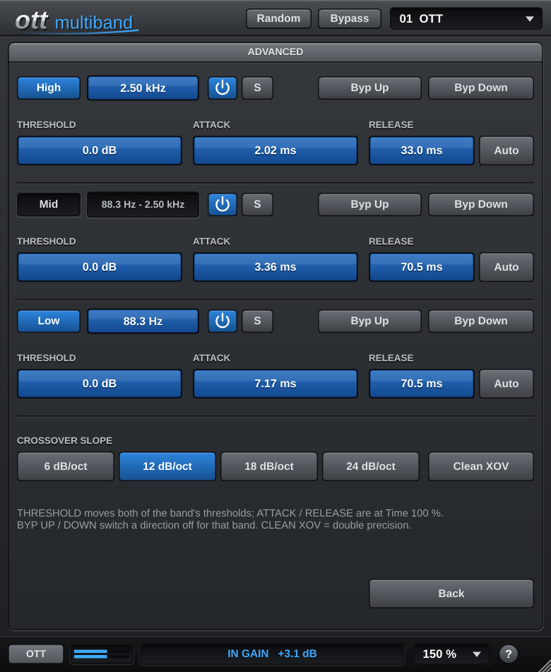

# OTT Multiband

A three-band upward + downward compressor built with JUCE 8 (C++17, CMake): **VST3** and
**Standalone** (plus **AU** on macOS). The engine follows a written DSP spec (below), with a
linear-phase crossover option, and the GUI is drawn in code in the VIRUS DELAY style, with no image
assets. The window is resizable.



## Controls

| Section | Controls |
|---------|----------|
| **Top** | **Depth** (how much of the effect is used; 0 % = untouched), **Time** (scales every attack / release), **In Gain**, **Out Gain**, **LINK** (on by default: turning In Gain up turns Out Gain down by the same amount), **Auto Gain** (on/off) |
| **Bands** | One row per band (H / M / L): **S** (solo), **A** (band auto gain), an **Amount** knob (0 % = no gain change on that band, 100 % = full, up to 150 %), a meter and the band's **Gain** |
| **Upward / Downward** | Upward and downward **strength**. **Linear Phase**, **Soft Knee**, **RMS**, **Advanced** |
| **Advanced** | Per band: split frequency with High / Low on/off, power (off = band passes untouched), **S**, **Byp Up** / **Byp Down**, **Threshold** (offset, double-click = 0), **Attack** and **Release** (at Time 100 %) with **Auto** release. **Crossover Slope** 6 / 12 / 18 / 24 dB/oct and **Clean XOV** |
| **Bars** | **Random**, **Bypass**, factory presets, **Size** (75-200 %), input peak meter (L / R), status line, help |



**Meter** (one per band): grey = the band's detector level, blue tick = up threshold, orange tick =
down threshold (a tick is hidden while that direction does nothing), orange segment = pushed down,
light-blue segment = lifted up, white tick = where the level ends up. The number on the right is the
gain change (plus the make-up, "A +x.x", when the band's auto gain is on).

### Mouse

* **Wheel**: 1.0 per notch in the control's own units (dB, ms, %, Hz). **Shift + wheel**: 0.1.
* **Drag** up/down (shift = fine). **Right-click** (or Ctrl-click) = type a value.
* **Double-click** resets: gain knobs and Threshold go to 0 dB, Amount to 100 %, everything else to its default.
* **Resize** by dragging the bottom-right corner, or pick 75-200 % in **SIZE**. The size is saved with the session.

## Engine

### Parameters (in this order: 0 - 19)

The normalised (0..1) value of every parameter follows the spec's mapping; the GUI shows the value in
real units (gains and thresholds in dB with one decimal place).

| # | Parameter | Mapping | Default |
|---|-----------|---------|---------|
| 0 | Depth | 0..1, shown as 0..100 % | 1.0 |
| 1 | Time | T = x <= 0.5 ? 2x : 1 + 18 (x - 0.5), at least 0.01; shown as % (100 % = T 1) | 0.5 (100 %) |
| 2 | In Gain | linear = x <= 0.5 ? 2x : 1 + 16 (x - 0.5) (0..9, 0.5 = unity); shown in dB, -inf .. +19.1 | 0.5 (0 dB) |
| 3 | Out Gain | same as In Gain | 0.5 (0 dB) |
| 4 | Clean XOV | bool: double-precision zero-latency crossover | off |
| 5-7 | Threshold L / M / H | offset in dB, **-40 .. +24** (see deviations) | 0 dB |
| 8-10 | Gain L / M / H | linear = 2x (0.5 = unity); shown in dB, -inf .. +6.0 | 0.5 (0 dB) |
| 11-13 | Byp Upwd L / M / H | bool | off |
| 14-16 | Byp Dnwd L / M / H | bool | off |
| 17 | Upwd Strength | 0..1, shown as % | 1.0 |
| 18 | Dnwd Strength | 0..1, shown as % | 1.0 |
| 19 | Bypass | bool | off |

Additions after these: In/Out Link, Auto Gain, Linear Phase, Soft Knee, RMS, the split frequencies
and High / Low on/off, Crossover Slope, and per band Amount, Active, Solo, Attack, Release,
Auto Release and Auto Gain.

### Signal chain (per sample, stereo; mono input is treated as L = R)

1. **Bypass**: passes the input through to the output unchanged (delayed by the plugin's latency, so
   nothing shifts in time; crossfaded over 30 ms).
2. **Smoothing**: Depth, In Gain and Out Gain use a one-pole with
   coef = 44100 / (fs x 300 + 44100), treating fs < 44000 as 44100.
3. **Split** into Low / Mid / High at 88.3 Hz and 2.5 kHz (adjustable on the Advanced page), then each
   band x In Gain x (0.52 x Depth + 1).
4. **Look-ahead**: the detector reads the current sample; the gain goes on the band sample 2 samples
   earlier. Reported to the host as latency (plus the linear-phase crossover's delay when it's on).
5. **Compressor** per band, stereo-linked:
   * p = L^2 + R^2 + 1e-25, one-pole smoothed (RMS window), level = sqrt (p)
   * envelope: if level > env: env += (level - env) x attackCoef, else env x= releaseCoef; values
     below 1e-10 are flushed to 0; env_dB = 20 log10 (env)
   * env_dB > downThr: gain_dB = (downRatio - 1)(env_dB - downThr), linear gain floored at 0.01 (-40 dB)
   * else -496 < env_dB < upThr: gain_dB = min ((upThr - env_dB) x upAmount, +36)
   * otherwise 0 dB
6. **Output** = (Low x GainL x (2.273047 D + 1) + Mid x GainM x (0.927525 D + 1)
   + High x GainH x (2.273047 D + 1)) x Out Gain, D = smoothed Depth.

**Coefficients** are recalculated only when a parameter they depend on changes:

* T = Time mapping above; attack = T x 0.15 x {47.8, 22.4, 13.5} ms, release = T x 0.25 x {282, 282, 132} ms
  (L / M / H), converted to one-pole coefficients at the current sample rate. The Advanced page shows
  the values at T = 1 (7.17 / 3.36 / 2.03 ms and 70.5 / 70.5 / 33.0 ms) and lets you change them.
* downThr = offset - {33.8, 30.2, 35.5} dB, upThr = offset - {40.8, 41.8, 40.8} dB
* s = clamp (2 x Depth x DnStrength, 0, 1); downRatio = Byp Dnwd ? 1 : 1 - s x {0.999, 0.99, 0.99}
* upAmount = Byp Upwd ? 0 : Depth x UpStrength x 1.5

**Metering** (lock-free atomics read by the GUI on a 30 Hz timer): input peak per channel with a linear
decay of 2.5e-5 per sample; per band the envelope level, the applied gain and the band auto-gain make-up.

### Choices made for [UNKNOWN] / [INFERRED] items

Each of these is a named constant in `Source/Parameters.h` (namespace `ott::Engine`) or noted here.

| Item | Choice |
|------|--------|
| RMS window [UNKNOWN] | `kRmsWindowMs` = 10 ms (one-pole) |
| Attack / release units [UNKNOWN] | milliseconds (`kAttackScale` 0.15, `kReleaseScale` 0.25 x the per-band bases) |
| Crossover topology [INFERRED] | Zero-latency mode: the input is split at the high frequency, the low part is split again at the low frequency, and the high band runs through the matching all-pass at the low frequency, so the three bands sum to a flat (all-pass) response at every slope. 24 dB/oct is the spec's Linkwitz-Riley 4th order (two cascaded Butterworth sections, Q = 0.7071) |
| Clean XOV coefficients [UNKNOWN] | The same compensated Linkwitz-Riley / Butterworth filters, computed in double precision (TPT state-variable form). Clean XOV off = float |
| Look-ahead buffer | 2 samples are needed, so a 4-sample ring per band (the spec's 32768-sample buffer isn't required) |
| Silence | The 1e-10 envelope flush means signals below about -156 dBFS never trigger upward gain (near-silence is never pumped up) |

### Deviations from the spec, and additions

* **Threshold range** is -40 .. +24 dB (requested earlier) instead of the spec's +/-24 dB, so the
  normalised Threshold value is a linear map of that range rather than (x - 0.5) x 48.
* **Crossover**: **Linear Phase** (on by default) uses zero-phase FIR filters (1 / (1 + (f/fc)^k), k = slope
  order) whose bands add back to the input exactly (null test), at the cost of ~43 ms latency. With
  Linear Phase off the zero-latency crossover above is used. The **Crossover Slope** default is
  12 dB/oct (chosen earlier for less ringing); 24 dB/oct matches the spec's LR4.
* **In Gain** is applied to the bands after the (linear) crossover, which is equivalent, so the dry
  path used by Bypass and Auto Gain stays the untouched input.
* **Soft Knee** (off by default; the spec is hard-knee) rounds both thresholds over 6 dB. **RMS** off
  skips the detector's smoothing (peak-style).
* **Amount** per band scales that band's gain change. **Auto release** per band: a fast (60 ms) and a
  slow (250 ms attack / 1.2 s release) envelope, the band follows the higher one.
* **Band auto gain (A)** cancels the loudness change the band's current gain curve applies to the last
  8 s of its input, with a correction for attack / release, so a setting change doesn't change the
  band's level. **Auto Gain** matches the output's K-weighted loudness (as in LUFS) to the input's.
* **Random** sets the sound-shaping controls to values within musically useful ranges, then restarts
  the compressors and fades the output in over 0.3 s so the jump can't cause a level spike. Bypass,
  Solo, Linear Phase, In / Out Gain, LINK and Auto Gain are left alone.

## Building

Requirements: CMake 3.22 or newer and a C++17 compiler (Visual Studio 2022 on Windows). JUCE 8.0.4 is
downloaded automatically; pass `-DJUCE_DIR=/path/to/JUCE` to use a local copy.

```bash
cmake -B build -G "Visual Studio 17 2022" -A x64        # Windows
cmake --build build --config Release --target OTT_VST3 OTT_Standalone OTT_Tests
build/OTT_Tests_artefacts/Release/OTT_Tests              # run the unit tests
```

On macOS / Linux use `cmake -B build -DCMAKE_BUILD_TYPE=Release` (macOS also builds `OTT_AU`).
Outputs are in `build/OTT_artefacts/Release/` (`VST3/OTT Multiband.vst3`, `Standalone/`, `AU/`).

Options: `-DOTT_BUILD_STANDALONE=OFF`, `-DOTT_BUILD_TESTS=OFF`, `-DOTT_COPY_AFTER_BUILD=ON` (installs
the plugin after building).

Every push to `main` builds the Windows VST3 and Standalone and the macOS VST3 installer on GitHub
Actions and runs the tests on both systems. The files are attached to the run and published to the
`builds` branch.

### Installing on macOS

Use `OTT-Multiband-VST3-macOS-Installer.pkg` (VST3 only, universal: Apple Silicon and Intel). It installs
`OTT Multiband.vst3` into `/Library/Audio/Plug-Ins/VST3`. Plugins put there by the installer don't carry
the "downloaded from the internet" flag, so Cubase opens them without the "Apple cannot check it for
malicious software" message.

The installer itself isn't signed with an Apple Developer ID, so the first time you open it macOS asks
about it: right-click (or Control-click) the .pkg and choose **Open**, then **Open** again. On macOS 15
or later, if there's no Open button, go to **System Settings > Privacy & Security**, scroll down to the
message about the installer and click **Open Anyway**. You only need to do this once per download.
Then rescan plugins in Cubase.

## Tests

`Tests/OttTests.cpp` (JUCE UnitTest, the `OTT_Tests` app; exits non-zero on failure):

* With Depth = 0 the crossover sums flat: linear phase is null-tested against the delayed input
  (residual about -155 dB at every slope); the zero-latency crossover, with and without Clean XOV,
  is checked for a flat magnitude at every slope (an all-pass sum can't null).
* With Depth = 0 there is no gain change and the output equals the delayed input.
* Loud sines are reduced and quiet sines boosted in every band, never by more than +36 dB, and the
  downward gain never goes below -40 dB. Byp Up / Byp Down switch each direction off.
* No NaN or denormal output with silence or full-scale noise, in both crossover modes; any sample rate
  and block size, mono and stereo.
* Parameter mappings and defaults, latency, bypass, state save / restore, band Amount, band and global
  auto gain, and Random.

## Project layout

```
CMakeLists.txt
.github/workflows/build.yml     Windows VST3 + Standalone build, tests, publish
Source/
  Parameters.h                  IDs, ranges, mappings, engine constants, formatting
  Presets.h                     factory presets
  PluginProcessor.h/.cpp        parameters, smoothing, split / compress / sum, metering, state
  PluginEditor.h/.cpp           scalable main view + Advanced page
  CustomLookAndFeel.h/.cpp      knobs, buttons, panels, LCDs (from VIRUS DELAY)
  UI/OttComponents.h/.cpp       knob / value-field mouse handling, band meters, help
  DSP/BandCompressor.h          per-band upward / downward compressor
  DSP/LinearPhaseCrossover.*    FIR crossover (linear phase)
  DSP/MinPhaseCrossover.h       zero-latency crossover (float, or double with Clean XOV)
Tests/OttTests.cpp              unit tests
```
